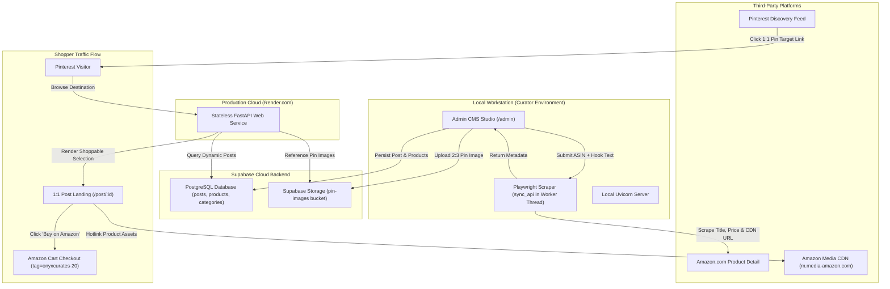

# Onyx Curates — Dynamic Pinterest-to-Amazon Affiliate Platform

[](https://fastapi.tiangolo.com)
[](https://www.python.org/)
[](https://supabase.com/)
[](https://tailwindcss.com/)
[](https://playwright.dev/)

A high-converting, category-agnostic **1:1 "Pin-to-Post"** affiliate marketing engine built with **FastAPI**, **Supabase PostgreSQL & Storage**, **SQLAlchemy**, **Playwright**, and **Tailwind CSS**.

Onyx Curates bridges the gap between high-aesthetic Pinterest discovery traffic and Amazon Associate conversions across **Tech**, **Decor**, **Gifts**, and **Fashion**.

---

## 💡 The Core Problem & Architectural Solution

### The Amazon Cold-Start Dilemma
The Amazon Associates Product Advertising API (PA-API 5.0) requires accounts to drive **3 qualifying sales within 180 days** before granting API access keys. Without API access, creators are trapped: they cannot dynamically fetch official product metadata, high-resolution media, or real-time pricing without violating operating guidelines.

### The Onyx Architecture
1. **Dual-Environment Strategy:**
   - **Local Studio (Admin CMS):** Runs locally on the curator's workstation. Features an automated headless Playwright engine that visits Amazon with anti-bot masking, enforces US/USD localization (`en-US`, `America/New_York`, and localization cookies), and scrapes verified product titles, live USD pricing, and official Amazon media CDN URLs (`m.media-amazon.com`).
   - **Public Cloud App (Render.com):** A lightning-fast, stateless web application backed by Supabase PostgreSQL and Supabase Object Storage. It serves pre-scraped, compliant affiliate destinations to thousands of Pinterest visitors with zero scraping overhead and zero cold-start delay.
2. **Ephemeral Disk Resilience:** Uploaded aesthetic pin images bypass server disks entirely and are stored directly in a public **Supabase Storage bucket (`pin-images`)**, guaranteeing zero asset loss across cloud container redeployments.
3. **1:1 Visual Congruence:** When a visitor clicks a Pinterest pin, they land on a dedicated target page displaying that exact visual anchor alongside contextual, curated affiliate links.

---

## 🏛️ System Architecture



---

## 🛠️ Tech Stack

| Layer | Technology | Purpose |
|---|---|---|
| **Backend Framework** | [FastAPI](https://fastapi.tiangolo.com/) (0.110+) | High-performance asynchronous REST & web routing |
| **Server Engine** | [Uvicorn](https://www.uvicorn.org/) (Standard) | Lightning-fast ASGI web server implementation |
| **Database & ORM** | [PostgreSQL](https://www.postgresql.org/) + [SQLAlchemy](https://www.sqlalchemy.org/) 2.0 | Relational models with cascade deletions and connection pooling |
| **Cloud Database** | [Supabase Database](https://supabase.com/database) | Managed PostgreSQL with automatic schema migration |
| **Object Storage** | [Supabase Storage](https://supabase.com/storage) | CDN-backed persistent image storage for ephemeral hosts |
| **Scraping Engine** | [Playwright](https://playwright.dev/python/) | Headless browser for Amazon metadata extraction |
| **Templating** | [Jinja2](https://jinja.palletsprojects.com/) 3.1+ | Server-side rendering with custom component hierarchy |
| **Styling** | [Tailwind CSS](https://tailwindcss.com/) (CDN) | Minimalist "Dark Mode Luxe" typography and UI layout |
| **Cloud Hosting** | [Render.com](https://render.com/) | Auto-deploying stateless web service hosting |

---

## 📂 Project Directory Structure

```
onyxcurates/
├── database.py              # SQLAlchemy engine, session maker & get_db dependency
├── models.py                # Category, Post, and Product models with cascade deletion
├── main.py                  # FastAPI application, public routes, admin CMS, scraper logic
├── requirements.txt         # Production dependencies for local dev & cloud deployment
├── .env.example             # Environment variable template
├── .env                     # Local configuration (database URL, Supabase, Amazon credentials)
├── test_app.py              # Full end-to-end test suite
├── static/
│   └── uploads/             # Local fallback upload directory (if Supabase is bypassed)
└── templates/
    ├── admin.html           # Dark-mode Tailwind CMS Studio dashboard
    ├── index.html           # Public landing page (Hero, Categories, Latest Drops)
    ├── category.html        # Category filter lookbook (/category/{slug})
    └── post.html            # 1:1 Pinterest conversion landing page (/post/{id})
```

---

## 🛡️ Amazon Associates & FTC Compliance

Onyx Curates is architected to strictly enforce Amazon Associates Operating Agreement policies:

1. **No Image Asset Storage:** Amazon strictly prohibits downloading, hosting, caching, or modifying Amazon product images. Product images are **never stored locally or in Supabase**; the application stores and renders only official Amazon CDN URLs (`https://m.media-amazon.com/images/I/...`).
2. **Mandatory FTC Disclosure:** Every public route ([`templates/index.html`](file:///d:/Documents/onyxcurates/templates/index.html), [`templates/category.html`](file:///d:/Documents/onyxcurates/templates/category.html), and [`templates/post.html`](file:///d:/Documents/onyxcurates/templates/post.html)) displays the mandatory FTC/Amazon Associate statement:
   > *"As an Amazon Associate, Onyx Curates earns from qualifying purchases."*
3. **Affiliate Tag Transparency:** Every outbound product button automatically appends the verified partner tracking tag:
   ```
   https://www.amazon.com/dp/{ASIN}?tag={AMAZON_PARTNER_TAG}
   ```
4. **Pricing Disclaimers:** All public views include time-of-retrieval disclaimers stating that product pricing and availability fluctuate on Amazon and that the price at checkout governs the purchase.

---

## ⚙️ Environment Configuration

Create a `.env` file in the project root based on `.env.example`:

```bash
cp .env.example .env
```

### Environment Variables Reference

```env
# -----------------------------------------------------------------------------
# Database Configuration
# -----------------------------------------------------------------------------
# Supabase PostgreSQL connection string (Transaction pooler or direct):
DATABASE_URL=postgresql://postgres:<password>@db.<project-ref>.supabase.co:5432/postgres

# (Optional fallback for zero-dependency local testing without cloud DB):
# DATABASE_URL=sqlite:///./onyxcurates.db

# -----------------------------------------------------------------------------
# Supabase Cloud Storage (Bucket: pin-images)
# -----------------------------------------------------------------------------
SUPABASE_URL=https://<project-ref>.supabase.co
SUPABASE_KEY=<your-supabase-anon-or-service-role-key>

# -----------------------------------------------------------------------------
# Amazon Associates Settings
# -----------------------------------------------------------------------------
AMAZON_PARTNER_TAG=onyxcurates-20
AMAZON_ACCESS_KEY=mock_access_key
AMAZON_SECRET_KEY=mock_secret_key
AMAZON_HOST=webservices.amazon.com
AMAZON_REGION=us-east-1

# -----------------------------------------------------------------------------
# Local Storage Fallback
# -----------------------------------------------------------------------------
UPLOAD_DIR=static/uploads
```

---

## 🚀 Local Development Setup

### 1. Prerequisites
- Python 3.10+ installed
- Git installed
- A free [Supabase](https://supabase.com/) project

### 2. Clone and Setup Environment

```bash
# Clone the repository
git clone https://github.com/yourusername/onyxcurates.git
cd onyxcurates

# Create Python virtual environment
python -m venv venv

# Activate virtual environment
# On Windows (PowerShell):
.\venv\Scripts\Activate.ps1
# On macOS / Linux:
source venv/bin/activate
```

### 3. Install Dependencies & Playwright Browser

```bash
# Install Python packages
pip install -r requirements.txt

# Install Playwright Chromium browser binary
playwright install chromium
```

### 4. Supabase Setup
1. Log into [Supabase Dashboard](https://supabase.com/dashboard).
2. Create a new project.
3. Under **Project Settings** &rarr; **Database**, copy your **Connection String (URI)** into `DATABASE_URL` in `.env`.
4. Under **Storage**, create a new bucket named **`pin-images`**.
5. Set the bucket to **Public** so uploaded pin hero images can be fetched by web visitors.

### 5. Run the Local Development Server

```bash
uvicorn main:app --reload --host 127.0.0.1 --port 8000
```

Once running, access the application locally:
- **Public Homepage:** [http://localhost:8000/](http://localhost:8000/)
- **Admin CMS Studio:** [http://localhost:8000/admin](http://localhost:8000/admin)
- **Interactive Swagger API Docs:** [http://localhost:8000/docs](http://localhost:8000/docs)

---

## 📌 Curator Workflow: Creating 1:1 Pinterest Pins

```
[Curator publishes aesthetic pin to Pinterest]
                    │
                    ▼
[Enters Pinterest Pin URL destination: https://yourdomain.com/post/42]
                    │
                    ▼
[Pinterest user clicks pin] ──► [Lands on exact matching 1:1 Post #42]
                                            │
                                            ▼
                           [Sees curated shoppable Amazon items]
                                            │
                                            ▼
                            [Clicks 'Buy on Amazon' -> Converts!]
```

### Step 1: Create the Post
1. Open [http://localhost:8000/admin](http://localhost:8000/admin).
2. Enter the **Post Title** (e.g., *"Minimalist Japandi Desk Setup"*). *Tip: Match your Pinterest Pin title word-for-word.*
3. Select the relevant Category (**Tech**, **Decor**, **Gifts**, or **Fashion**).
4. Drop your high-resolution 2:3 pin image into the upload box.
5. Click **Publish Post**. The image is uploaded directly to your Supabase `pin-images` storage bucket, and the database record is created.

### Step 2: Attach Shoppable Amazon Items
1. In the **Published Posts** list on the Admin dashboard, find your new post.
2. Click **+ Add Amazon Item to Post #{id}**.
3. Enter the target item's **Amazon ASIN** (e.g. `B0C7JYTN78` from `amazon.com/dp/B0C7JYTN78`).
4. Enter an editorial **Contextual Hook Text** (e.g. *"The exact matte black aluminum monitor riser shown on the desk"*).
5. Click **Link Product**.
   - Playwright launches headlessly with US locale and USD cookies.
   - It scrapes the live Amazon product title, high-resolution CDN image, and current price.
   - It formats the compliant affiliate link with your partner tag (`tag=onyxcurates-20`).

### Step 3: Link on Pinterest
1. Click **Copy Pin URL** on the post card (e.g. `https://yourdomain.com/post/42`).
2. Paste this link into the **Destination URL** field when publishing your pin on Pinterest.
3. When Pinterest users click through, they see the exact visual pin and shoppable Amazon affiliate products.

---

## 🌐 Production Deployment (Render.com)

Because Render uses ephemeral container disks, the app is architected so that **all state resides in Supabase**:
- Relational data &rarr; Supabase PostgreSQL
- Pin image uploads &rarr; Supabase Object Storage (`pin-images`)
- Product images &rarr; Amazon Media CDN (`m.media-amazon.com`)

### Step-by-Step Render Deployment

1. **Push your code to GitHub / GitLab.**
2. Go to [Render.com Dashboard](https://dashboard.render.com/) and click **New** &rarr; **Web Service**.
3. Connect your repository.
4. Configure the service settings:
   - **Name:** `onyxcurates`
   - **Environment:** `Python 3`
   - **Region:** Any (e.g. Oregon, Frankfurt)
   - **Branch:** `main`
   - **Build Command:**
     ```bash
     pip install -r requirements.txt
     ```
   - **Start Command:**
     ```bash
     uvicorn main:app --host 0.0.0.0 --port $PORT
     ```
5. Add the **Environment Variables** under Render's Environment tab:
   | Key | Value |
   |---|---|
   | `DATABASE_URL` | Your Supabase PostgreSQL connection string |
   | `SUPABASE_URL` | `https://<your-project-ref>.supabase.co` |
   | `SUPABASE_KEY` | Your Supabase key |
   | `AMAZON_PARTNER_TAG` | `onyxcurates-20` |
6. Click **Create Web Service**. Render will build and deploy the application.

---

## 🧪 Testing

The repository includes a comprehensive automated test script ([`test_app.py`](file:///d:/Documents/onyxcurates/test_app.py)) verifying all major system routes:

```bash
python test_app.py
```

### Test Suite Coverage
1. **Default Category Seeding:** Verifies `Tech`, `Decor`, `Gifts`, and `Fashion` populate automatically.
2. **Public Homepage (`GET /`):** Validates 200 OK status and aesthetic brand layout.
3. **Category Filtering (`GET /category/{slug}`):** Tests filtered views for all categories.
4. **Admin Dashboard (`GET /admin`):** Confirms CMS studio renders with form controls.
5. **Post Creation (`POST /admin/create-post`):** Tests image upload, filename hashing, and database persistence.
6. **Product Attachment (`POST /admin/post/{id}/add-product`):** Tests scraping resolution, CDN URL mapping, and affiliate tag injection.
7. **1:1 Pinterest Landing Page (`GET /post/{id}`):** Validates visual congruence and mandatory Amazon Associate legal disclosure.

---

## 📄 License

Distributed under the MIT License. See `LICENSE` for more information.

---

## 🤝 Contributing

Contributions, issues, and feature requests are welcome. Feel free to open a PR or submit an issue to improve scraper resilience, add additional category templates, or expand cloud storage adapters.
